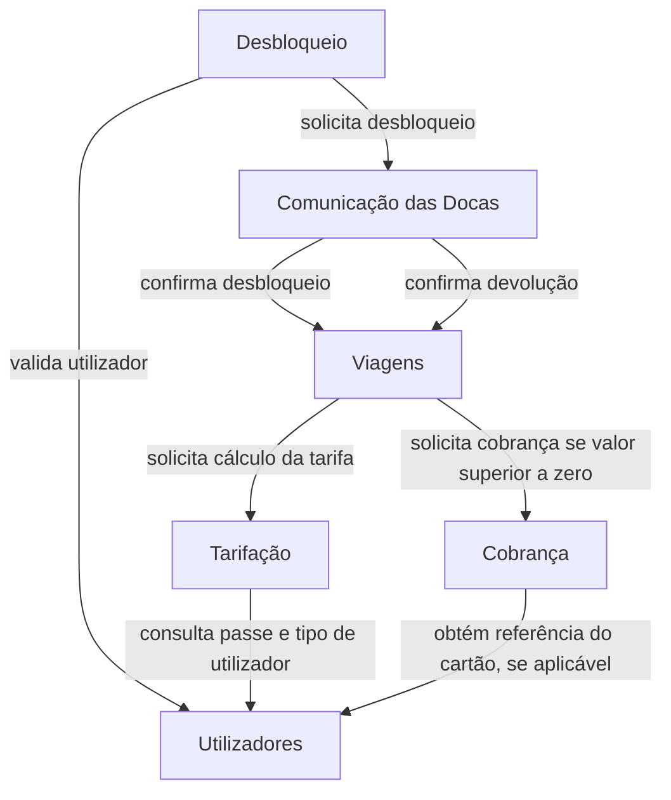

# 03 - Particionamento e Vistas

## 1. Particionamento de topo

Foi escolhido o particionamento **por domínio**, porque a decomposição anterior, feita através de workflows, já separou o sistema segundo responsabilidades de negócio, como Viagens, Manutenção, Faturação, Estações e Redistribuição.

Esta opção facilita a organização dos componentes por área funcional e torna mais simples perceber onde deve ficar cada responsabilidade.

Como trade-off, exige maior atenção às dependências entre domínios e pode levar à repetição de alguns aspetos técnicos em diferentes áreas.

## 2. Vista de módulos

### Domínio de Operação de Viagens

- Utilizadores
- Desbloqueio
- Viagens
- Tarifação
- Cobrança
- Histórico de Viagens
- Faturação

### Domínio de Operação de Estações

- Comunicação das Docas
- Consulta de Estações

### Domínio de Redistribuição

- Planeamento de Redistribuição
- Planeamento de Rotas 

### Domínio de Manutenção da Frota

- Telemetria
- Manutenção

### Domínio de Reporting Municipal

- Relatórios Municipais

## 3. Regras allowed-to-use

As dependências dentro do mesmo domínio são permitidas quando correspondem às responsabilidades definidas para os componentes.

As dependências entre domínios são restritas às seguintes relações:

- **Operação de Viagens** pode usar **Operação de Estações**, nomeadamente através da comunicação com as docas necessária ao desbloqueio das bicicletas.
- **Operação de Estações** pode usar **Operação de Viagens**, nomeadamente quando Comunicação das Docas informa Viagens das confirmações de desbloqueio e devolução.
- **Redistribuição** pode usar **Operação de Estações** para obter os dados de ocupação necessários ao equilíbrio das estações.
- **Reporting Municipal** pode consultar diretamente a base de dados, apenas em leitura, através de queries definidas no próprio componente.
- **Manutenção da Frota** não depende funcionalmente dos restantes domínios.

Não são permitidas outras dependências entre domínios.

Adicionalmente:

- **Reporting Municipal** apenas consome informação e não deve ser usado pelos restantes domínios.
- As dependências devem respeitar as responsabilidades definidas para cada componente, evitando acessos diretos desnecessários.
- O mecanismo utilizado para transportar uma comunicação não altera as regras de dependência lógica entre os módulos.

## 4. Vista de Componentes e Conectores

A vista de componentes e conectores representa as interações do fluxo principal **desbloquear → devolver → cobrar**.

Os pagamentos por cartão ou MB WAY são simulados em Cobrança. A consulta de Cobrança a Utilizadores ocorre apenas no pagamento com cartão associado.

### Legenda

As comunicações representadas neste fluxo são síncronas (request/response), permitindo obter diretamente o resultado de cada chamada.

- **Desbloqueio → Utilizadores**: é solicitada a identificação e validação do utilizador.
- **Desbloqueio → Comunicação das Docas**: é enviado o pedido de desbloqueio e aguardado o respetivo resultado.
- **Comunicação das Docas → Viagens (desbloqueio)**: após a confirmação do desbloqueio físico da bicicleta, é iniciada a viagem.
- **Comunicação das Docas → Viagens (devolução)**: após a confirmação do encaixe da bicicleta, a viagem é fechada e guardada.
- **Viagens → Tarifação**: depois de a viagem estar fechada, é solicitado o cálculo do valor a pagar.
- **Tarifação → Utilizadores**: são consultados o passe e o tipo de utilizador para aplicar o tarifário.
- **Viagens → Cobrança**: depois de calculada a tarifa, é solicitado o processamento da cobrança, caso o valor seja superior a zero.
- **Cobrança → Utilizadores**: é obtida a referência do cartão associado, quando esse método de pagamento é utilizado.

Optou-se por comunicação síncrona neste fluxo por se tratar do caminho principal da operação, em que existe dependência direta entre os passos e necessidade de uma resposta imediata ao utilizador.

## 5. Vista de Alocação

A vista de alocação representa a distribuição dos principais elementos do sistema pela infraestrutura onde são executados.

A aplicação cliente é executada nos dispositivos dos utilizadores e comunica com o sistema através da Internet.

O backend principal, o domínio de Manutenção da Frota, a base de dados e o broker são alojados em infraestrutura cloud, recorrendo a serviços geridos. O backend principal é executado em múltiplas instâncias equivalentes, atrás de um balanceador de carga, para aumentar a disponibilidade e permitir ajustar a capacidade à procura.

O sistema possui um **backend principal**, onde ficam os domínios de:

- Operação de Viagens;
- Operação de Estações;
- Reporting Municipal.
- Redistribuição

Estes domínios permanecem no mesmo deploy, embora separados internamente em módulos.

Esta opção evita introduzir complexidade distribuída desnecessária, uma vez que Operação de Viagens e Operação de Estações colaboram frequentemente e são afetadas por períodos de maior utilização semelhantes.

O domínio de **Manutenção da Frota** é executado separadamente do backend principal e contém os componentes Telemetria e Manutenção.

Esta separação deve-se ao perfil operacional diferente deste domínio, uma vez que recebe e processa continuamente os dados enviados pelas bicicletas elétricas, permitindo atribuir-lhe recursos próprios e isolar falhas do respetivo processo.

O sistema utiliza uma **base de dados partilhada** entre o backend principal e o domínio de Manutenção da Frota.

Apesar de esta opção aumentar algum acoplamento entre os dois, reduz a complexidade associada à sincronização, consistência e duplicação de dados entre diferentes bases de dados.

É também utilizado um **broker de mensagens**, principalmente para suportar fluxos assíncronos que não necessitam de resposta imediata.

Um exemplo é:

- Telemetria → Manutenção.

A utilização de um único broker evita aumentar a complexidade da infraestrutura através da introdução de vários mecanismos de mensagens independentes.

As **estações e docas** estão distribuídas fisicamente pela cidade e comunicam com o backend principal. Esta comunicação é utilizada em operações como desbloqueio de bicicletas, devolução e atualização do estado das estações.

As **bicicletas elétricas** enviam periodicamente dados de telemetria, que são tratados pelo domínio de Manutenção da Frota.

O processamento dos pagamentos por cartão ou MB WAY é simulado no componente **Cobrança**, sem integração com um sistema de pagamentos externo.

### Decisões de alocação

As principais decisões tomadas foram:

- utilizar infraestrutura cloud com serviços geridos e múltiplas instâncias do backend principal atrás de um balanceador de carga;
- manter Operação de Viagens, Operação de Estações, Reporting Municipal e Redistribuição no mesmo backend principal;
- separar o domínio de Manutenção da Frota devido ao seu perfil de carga diferente e para isolar falhas do respetivo processo;
- utilizar uma base de dados partilhada;
- utilizar um único broker de mensagens para os fluxos assíncronos;
- manter comunicação síncrona no fluxo crítico de desbloquear, devolver e cobrar.

Esta solução procura equilibrar disponibilidade, separação de responsabilidades, simplicidade operacional e capacidade de evolução futura. Mantêm-se os domínios do backend principal no mesmo deploy para evitar chamadas de rede e coordenação entre serviços separados, aceitando a complexidade de gerir múltiplas instâncias e balanceamento de carga para melhorar a disponibilidade.

### Responsabilidade pelos componentes

A responsabilidade pelos componentes foi distribuída por domínio, de forma a manter cada elemento do grupo responsável por conjuntos funcionais coerentes.

| Domínio | Componente | Responsável |
|---|---|---|
| Operação de Viagens | Utilizadores | Matilde |
| Operação de Viagens | Desbloqueio | Matilde |
| Operação de Viagens | Viagens | Matilde |
| Operação de Viagens | Tarifação | Matilde |
| Operação de Viagens | Cobrança | Matilde |
| Operação de Viagens | Histórico de Viagens | Matilde |
| Operação de Viagens | Faturação | Matilde |
| Reporting Municipal | Relatórios Municipais | Matilde |
| Operação de Estações | Comunicação das Docas | João |
| Operação de Estações | Consulta de Estações | João |
| Redistribuição | Planeamento de Redistribuição | João |
| Redistribuição | Planeamento de Rotas | João |
| Manutenção da Frota | Telemetria | João |
| Manutenção da Frota | Manutenção | João |

Esta distribuição segue o particionamento por domínio e evita que a responsabilidade sobre componentes fortemente relacionados fique fragmentada entre os elementos do grupo.

A mesma distribuição deve ser refletida no ficheiro `CODEOWNERS`.