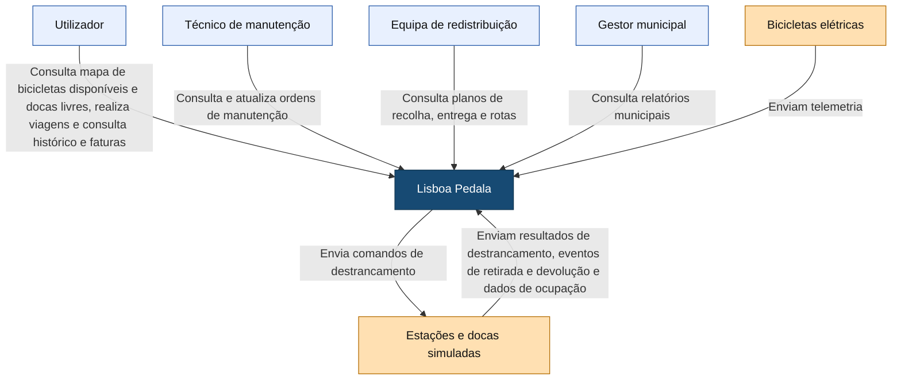

# C4 — Nível 1: Contexto

O diagrama apresenta quem utiliza o Lisboa Pedala e os equipamentos com que comunica, sem detalhar a organização interna da plataforma.

## Legenda

- **Azul-claro:** pessoas ou equipas que utilizam a plataforma.
- **Azul-escuro:** sistema Lisboa Pedala.
- **Laranja-claro:** equipamentos que comunicam com a plataforma.
- **Seta:** interação no sentido indicado, descrita pelo respetivo texto.

As docas são simuladas. Não são representados serviços externos de pagamentos ou de validação do cartão Navegante, pois essas operações também são simuladas.