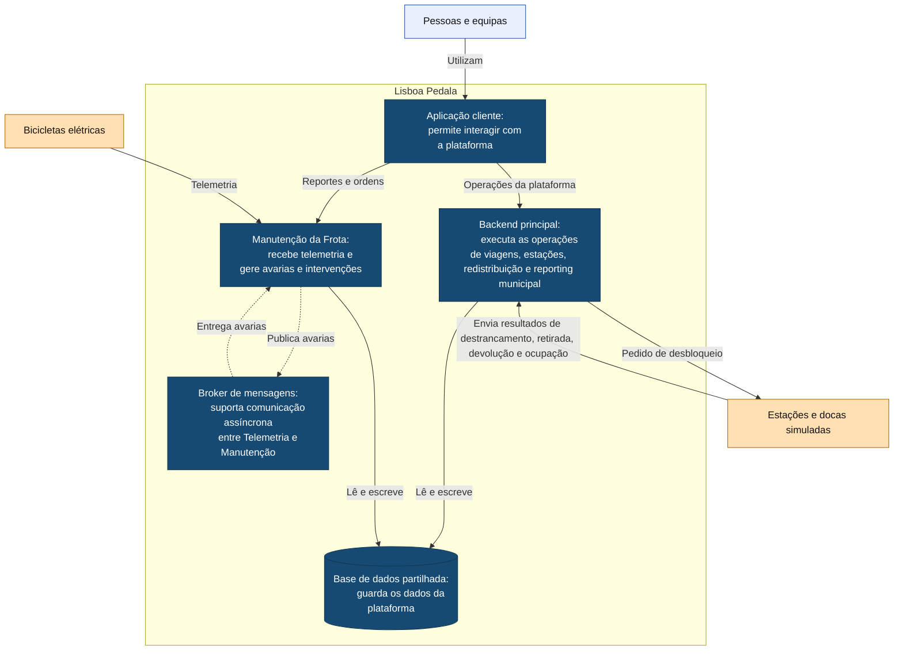

# C4 — Nível 2: Contentores

O diagrama mostra as principais aplicações e armazenamentos do Lisboa Pedala e as comunicações entre eles.

## Legenda

- **Azul-claro:** pessoas ou equipas que utilizam a plataforma.
- **Azul-escuro:** aplicações e armazenamentos internos do Lisboa Pedala.
- **Laranja-claro:** equipamentos que comunicam com a plataforma.
- **Retângulo com o nome Lisboa Pedala:** fronteira do sistema.
- **Cilindro:** base de dados.
- **Seta contínua:** pedido, acesso a dados ou envio de informação, conforme o texto.
- **Seta tracejada:** comunicação assíncrona através do broker.

As chamadas da aplicação cliente e os pedidos diretos às docas usam comunicação síncrona request/response. Os eventos físicos de retirada, devolução e outros resultados podem ser recebidos posteriormente e reenviados após falhas de ligação. As docas recebem comandos de destrancamento e enviam resultados da operação e eventos físicos de retirada e devolução, além dos dados de ocupação.

No backend principal, Reporting apenas lê os dados operacionais.

Telemetria recebe os dados das bicicletas e atualiza o respetivo estado. Quando identifica uma avaria, publica uma mensagem no broker para processamento por Manutenção. Ambos os componentes pertencem à aplicação Manutenção da Frota.