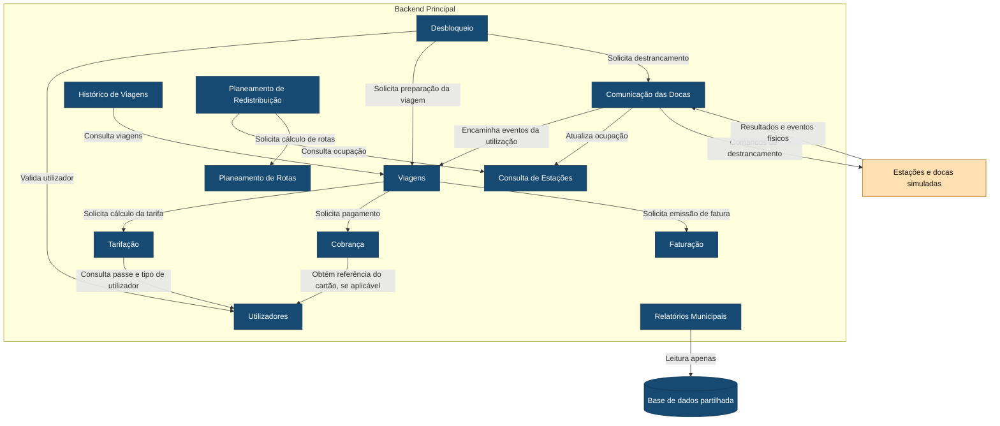

# C4 — Nível 3: Componentes do Backend Principal

Este diagrama apresenta os componentes internos do Backend Principal e as dependências permitidas entre eles.

## Legenda

- **Azul-escuro:** componentes e armazenamento internos do Lisboa Pedala.
- **Laranja-claro:** equipamentos que comunicam com a plataforma.
- **Retângulo com o nome Backend Principal:** fronteira do contentor detalhado.
- **Cilindro:** base de dados.
- **Seta:** dependência ou comunicação no sentido indicado.

As dependências entre componentes correspondem às regras `allowed-to-use` definidas em `ARCHITECTURE.md`. As interações diretas entre estes componentes usam comunicação síncrona request/response. Os eventos físicos das docas são recebidos em momentos distintos e encaminhados por Comunicação das Docas.

Desbloqueio coordena o acesso. Solicita a Viagens a verificação da exclusividade do utilizador e da bicicleta e a criação do registo pendente antes de solicitar o destrancamento.

Os resultados e eventos físicos enviados pelas docas incluem falhas de destrancamento, retirada, devolução, expiração do prazo com bloqueio confirmado e dados de ocupação. Comunicação das Docas encaminha os resultados da utilização para Viagens e as atualizações de ocupação para Consulta de Estações.

Viagens gere os estados do registo. A retirada confirmada marca o início da viagem e o encaixe confirmado marca o fim, usando os instantes físicos registados pelas docas. Após o fecho, coordena Tarifação, Cobrança e Faturação, cuja lógica permanece nos respetivos componentes.

Relatórios Municipais consulta diretamente a base de dados partilhada apenas em leitura. A ligação à BD é destacada para explicitar esta decisão; os acessos de persistência dos restantes componentes foram omitidos para simplificar o diagrama.