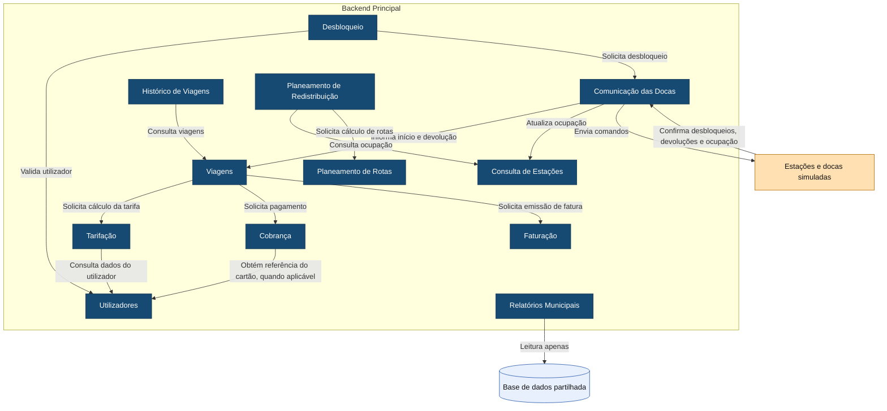

# C4 — Nível 3: Componentes do Backend Principal

Este diagrama apresenta os componentes internos do Backend Principal e as dependências permitidas entre eles.

## Legenda

- **Azul-escuro:** componentes internos do Backend Principal.
- **Laranja-claro:** equipamentos externos simulados.
- **Azul-claro/cilindro:** armazenamento de dados.
- **Seta:** dependência ou comunicação no sentido indicado.

As dependências apresentadas correspondem às regras `allowed-to-use` definidas em `ARCHITECTURE.md`.

O componente Viagens coordena o fecho da viagem, a tarifação, a cobrança e a faturação, mas cada uma destas responsabilidades permanece no respetivo componente.

Relatórios Municipais não depende dos restantes componentes lógicos. Consulta diretamente a base de dados partilhada apenas em leitura.