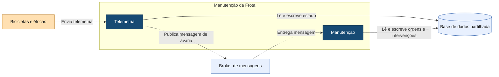

# C4 — Nível 3: Componentes de Manutenção da Frota

Este diagrama apresenta os componentes internos da aplicação Manutenção da Frota e a comunicação assíncrona utilizada no tratamento de avarias identificadas através da telemetria.

## Legenda

- **Azul-escuro:** componentes internos da aplicação Manutenção da Frota.
- **Laranja-claro:** equipamento externo.
- **Azul-claro:** infraestrutura e armazenamento partilhado.
- **Seta contínua:** envio ou acesso direto a dados.
- **Seta tracejada:** comunicação assíncrona através do broker.

As bicicletas elétricas enviam telemetria para o componente Telemetria.

Quando a Telemetria identifica uma avaria, publica uma mensagem no broker. O componente Manutenção recebe posteriormente essa mensagem e pode criar uma ordem de manutenção.

A comunicação `Telemetria → Manutenção` é, por isso, assíncrona e não exige que Telemetria espere pela criação da ordem.