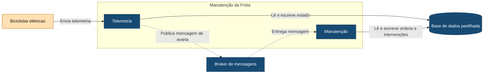

# C4 — Nível 3: Componentes de Manutenção da Frota

Este diagrama apresenta os componentes internos da aplicação Manutenção da Frota e a comunicação assíncrona utilizada no tratamento de avarias identificadas através da telemetria.

## Legenda

- **Azul-escuro:** componentes, broker e armazenamento internos do Lisboa Pedala.
- **Laranja-claro:** equipamento externo.
- **Seta contínua:** envio ou acesso direto a dados.
- **Seta tracejada:** comunicação assíncrona através do broker.

As bicicletas elétricas enviam telemetria para o componente Telemetria.

Quando Telemetria identifica uma avaria, publica uma mensagem no broker. Manutenção consome-a e cria uma ordem pendente de avaliação pelo técnico, sem duplicar ordens quando a mesma mensagem é novamente entregue.

A comunicação `Telemetria → Manutenção` é, por isso, assíncrona e não exige que Telemetria espere pela criação da ordem.